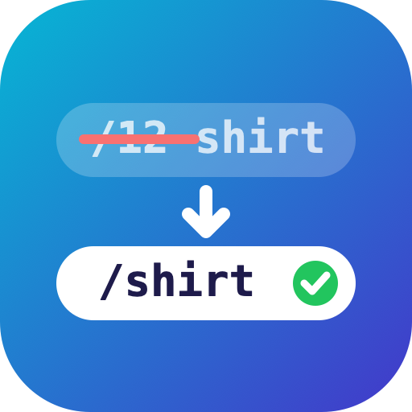

# Clean URLs - Remove IDs, 301 Redirects & SEO URLs

Remove the ID numbers from your PrestaShop 9 URLs, with automatic 301 redirects, a redirect manager, a 404 monitor, duplicate URL fixing and a live XML sitemap.

Free and open source (AFL-3.0).

| Page | Before | After |
|---|---|---|
| Product | `/1-1-hummingbird-printed-t-shirt.html` | `/men/hummingbird-printed-t-shirt.html` |
| Category | `/3-clothes` | `/clothes` |
| CMS page | `/content/1-delivery` | `/content/delivery` |
| Brand | `/brand/1-studio-design` | `/brand/studio-design` |
| Supplier | `/supplier/1-fashion-supplier` | `/supplier/fashion-supplier` |

## Features

**Clean URLs**
- Products, categories, CMS pages, CMS categories, brands and suppliers
- A customizable pattern per page type (`{rewrite}`, `{category:/}`, `{categories:/}`), each switchable on or off
- All languages of the shop
- Product combinations keep working: the variant travels in the `#/2-size-m/11-color-black` part, and the product page selects it

**Never lose traffic**
- Every old URL with an ID gets a **301** to its new address (query strings kept)
- **Renamed URLs are remembered**: change a product's friendly URL, and the old one still redirects
- **Redirect manager**: 301, 302, 303, 307 and 308, matching an exact URL, a prefix or a regular expression (`$1` in the target), with hit counters
- **404 monitor**: missing URLs with hits and referrer, plus a one-click "Redirect" button

**Stay clean**
- **Duplicate URL finder**: same slug twice, or a category clashing with a store page (contact-us…), with one-click fixing (`slug-2`, `slug-3`, and the old URL redirects)
- **Live XML sitemap** at `/sitemap.xml`: products, categories, CMS, brands and suppliers, with hreflang for every language and product images. No cron job. One click adds it to robots.txt.

**Built right**
- **No overrides.** Uses PrestaShop's own routing hooks (`actionAfterLoadRoutes`, `actionDispatcherBefore`), so it survives PrestaShop updates and doesn't clash with other modules' overrides
- 10 languages: English, French, Spanish, Italian, Polish, German, Czech, Dutch, Portuguese, Russian
- PDF user guide in all 10 languages, in [`docs/`](docs/)

## Requirements
- PrestaShop 9.0+
- PHP 8.1+
- Friendly URLs turned on (Shop Parameters > Traffic & SEO)

## Installation
1. Download `cleanurls-x.y.z.zip` from the Releases page.
2. Back office → **Modules → Module Manager → Upload a module**.
3. Click **Configure**, check the before/after table, then clear the cache (Advanced Parameters > Performance).

> Keep the module installed once your clean URLs are live. Uninstalling brings back the URLs with IDs.

## Author and support
- Email: iamshoaibktk@gmail.com
- WhatsApp: +923459016286

## License
[Academic Free License 3.0 (AFL-3.0)](https://opensource.org/licenses/AFL-3.0)
